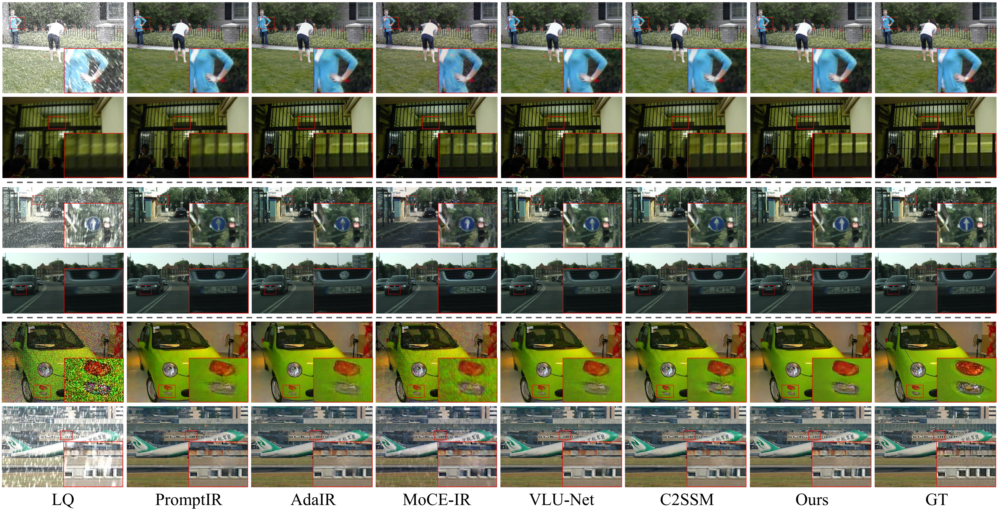
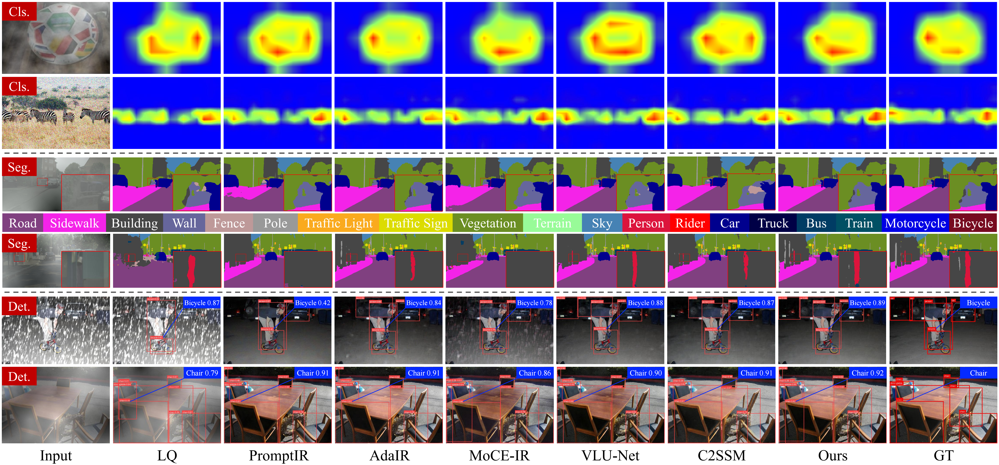

# TaskIR: Task-Driven Image Restoration via Degradation Adaptation and Task Feedback

---

## 🔥 Updates

- Code and pretrained TaskIR checkpoints are available for research reproducibility.

## 📖 Method Overview


Overview of the proposed TaskIR framework and its key components: (a) Overall architecture of TaskIR; (b) Task-to-restoration feedback generation (TRFG); (c) Degradation-guided transformer block (DGTB); (d) Degradation representation module (DRM); and (e) Degradation-conditioned parameter generator (DPG).

## 🛠️ Environment Setup

We recommend using Conda to create a clean environment.

```bash
conda create -n taskir python=3.10 -y
conda activate taskir
```

Install PyTorch with CUDA 11.8:

```bash
pip install torch==2.4.0+cu118 torchvision==0.19.0+cu118 --index-url https://download.pytorch.org/whl/cu118
```

Install the remaining dependencies:

```bash
pip install -r requirements.txt
```

## 📂 Dataset Preparation

The experiments are conducted on three datasets corresponding to different downstream tasks:

- **ImageNet-1K:** Image classification
- **Cityscapes:** Semantic segmentation
- **PASCAL VOC 2012:** Object detection

After preparing the datasets, run the following scripts to generate the required JSON metadata files:

```bash
python generate_data/Classification/process_imagenet1k.py
python generate_data/Segmentation/process_cityscapes.py
python generate_data/Detection/process_voc2012.py
```

The processed low-quality (LQ) datasets used in the experiments are not currently included in this repository.

## 💪 Pretrained Weights

The pretrained TaskIR checkpoints are provided in the repository:

| Stage | Checkpoint Path |
|---|---|
| Stage I: Restoration | `checkpoints/restore/latest_iter.pth` |
| Stage II: Task Feedback | `checkpoints/feedback/latest_iter.pth` |

**Downstream Task Networks**

TaskIR utilizes pretrained downstream task networks for classification, segmentation, and detection.

The corresponding pretrained task-network checkpoints should be placed under `downstream/` according to the loading paths specified in the implementation.

## 🚀 Training

TaskIR follows a two-stage training strategy: **Stage I Restoration Training** and **Stage II Task Feedback Training**.

### Stage I: Restoration Training

Train the degradation-adaptive restoration network using four GPUs:

```bash
CUDA_VISIBLE_DEVICES=0,1,2,3 torchrun --standalone --nproc_per_node=4 train.py \
  --stage restore \
  --batch_size 8 \
  --max_iters 200000
```

The Stage I checkpoint is saved under:

```text
checkpoints/restore/
```

### Stage II: Task Feedback Training

After completing Stage I, train the task-feedback modules using the pretrained restoration checkpoint:

```bash
CUDA_VISIBLE_DEVICES=0,1,2,3 torchrun --standalone --nproc_per_node=4 train.py \
  --stage feedback \
  --restore_ckpt checkpoints/restore/latest_iter.pth \
  --batch_size 8 \
  --max_iters 100000
```

The Stage II checkpoint is saved under:

```text
checkpoints/feedback/
```

## 🌍 Inference

To perform inference using the provided pretrained checkpoints, run:

```bash
python test.py \
  --restore_ckpt checkpoints/restore/latest_iter.pth \
  --feedback_ckpt checkpoints/feedback/latest_iter.pth \
  --output_path test_results/Ours \
  --task all
```

The `--task` argument specifies the downstream task:

| Option | Downstream Task |
|---|---|
| `all` | All downstream tasks |
| `cls` | Image classification |
| `seg` | Semantic segmentation |
| `det` | Object detection |

For example, to run inference for semantic segmentation:

```bash
python test.py \
  --restore_ckpt checkpoints/restore/latest_iter.pth \
  --feedback_ckpt checkpoints/feedback/latest_iter.pth \
  --output_path test_results/Ours \
  --task seg
```

## 📊 Evaluation

Evaluate the restored results for all downstream tasks:

```bash
python eval_restored_results.py \
  --task all \
  --results_root test_results \
  --output_root evaluation_results \
  --save_visualizations
```

Individual tasks can be evaluated by specifying `--task cls`, `--task seg`, or `--task det`.

For example, to evaluate semantic segmentation:

```bash
python eval_restored_results.py \
  --task seg \
  --results_root test_results \
  --output_root evaluation_results/seg \
  --save_visualizations
```

## ✨ Qualitative Results

### Image Restoration

Qualitative comparison of image restoration results under diverse degradations on ImageNet-1K, Cityscapes, and PASCAL VOC 2012.



### Downstream Task Performance

Qualitative comparison of downstream task results under diverse degradations, including image classification (Cls.), semantic segmentation (Seg.), and object detection (Det.).


